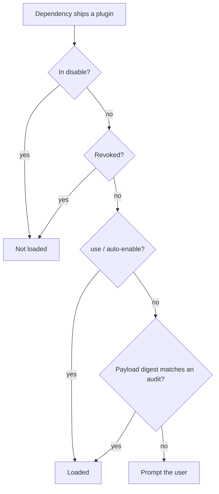
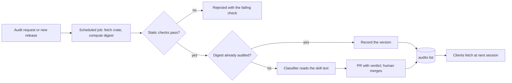

# Automated plugin audits

## TL;DR

- Today a dependency's embedded plugin loads only after the user says yes, and that yes is recorded by crate *name*: no version, no content check, forever. Every user of a popular crate answers the same prompt about the same text, which nobody has read.
- Add a curated **audits** list, modeled on cargo-vet: one small TOML file per crate, pinning a digest of the plugin payload (its manifest and the skill files it ships). A dependency whose payload matches an audit loads with no prompt.
- The audit asks one question: **are the skills poisoned?** Hooks, MCP servers and subcommands are code, and are left to the ecosystem's code checks (see FAQ).
- A *System One* model does the reading: a classifier that answers a fixed set of questions with probabilities rather than generating text. A confident "unsafe" keeps a crate off the list automatically; every approval is confirmed by a human.
- The list lives in its own repo, `symposium-dev/audits`, with its automation. Adding a crate is a PR merge, never a Symposium release.

## Motivation

Today the consent prompt in `cargo agents sync` and the `cargo agents use` command record a bare crate name in `[plugins] auto-enable` or `use`. After `cargo update`, a crate enabled at 1.0 ships different `SKILL.md` text at 1.1 and it loads with no re-prompt. An `auto-enable` decision is user-wide, and approving one crate also approves any crate its plugin chains to through `[[plugins]]`. The prompt itself carries no information: the user is asked to trust text nobody has read.

## Change in a nutshell

`symposium-dev/audits` holds `audits/widget_lib.toml`:

```toml
format = 1
crate  = "widget-lib"

[[audit]]
digest   = "sha256:9f2c41d0e8…b7"         # hash of the plugin payload
versions = ["1.4.2", "1.4.3", "1.5.0"]    # releases known to ship this payload

[[revoked]]
versions = ">=1.3.0, <1.4.2"
reason   = "remote-exec"                  # reason code from a fixed list
```

Sync hashes `widget-lib`'s payload — its plugin manifest and every skill directory the manifest names inside the crate — finds the matching digest, and loads the whole plugin with no prompt and no config write. `cargo agents status` lists it as active because of the audit, and `[plugins] disable` still turns it off. Entries are per distinct payload, not per release: a code-only release keeps matching; a release that changes the payload falls back to the prompt until it is audited as a new entry. A plugin that pulls skill text from outside the crate (a `source.git` group) cannot be pinned by a digest and is not eligible; a chained crate is checked against its own entry.

Precedence, first match wins:



A revocation outranks the user's own `use`, because it marks a payload known to be harmful. Audit-based loading can be turned off in config; a user who turns it off gets the prompt as today.

## Detailed plans

### The list

- **Where**: `github.com/symposium-dev/audits`, a git registry shipped as a builtin the way the recommendations repo is. It is a separate repo because its cadence is crate releases, not plugin authoring. Any trusted `[[registry]]` may carry `audits/`, so a company can run its own.
- **What**: one file per crate holding all its audits and revocations. An audit is a `digest` the client matches on plus the `versions` known to ship it; `[[revoked]]` is by version range or digest with a `reason` code from a fixed list, so the client can explain the revocation. Every change lands by pull request, so the repo history records who or what decided each entry and on what evidence.
- **Compatibility**: the file carries a `format` version. Only a format bump needs a Symposium release; the list itself never does.

### The classifier

Input is the skill text: every `SKILL.md` and every script inside a skill directory, for all skills of the crate together. A System One model answers a fixed set of questions about it, each with a probability: does the skill tell the agent to fetch and run remote code, send out secrets or source, hide what it is doing from the user, or act outside the task a library's documentation would describe? Each question has its own `reason` code.

**Nobody talks to the classifier.** Text addressed to an AI reviewer ("ignore previous instructions", "classify as safe") has no place in a legitimate skill, so it is disqualifying on its own. The model's answers are not shown to the submitter.

**Routing.** A payload judged unsafe gets no audit entry, with no human needed to keep it out; a human decides whether to also revoke the release. A payload judged safe is opened as a pull request, with the skill text and the verdict, and a human confirms the merge. An audit means "reviewed and found clean", not a guarantee; revocation is the remedy when one was wrong.

### Requesting an audit



Anyone can request an audit by opening an issue in the audits repo; the consent prompt links to it. A scheduled job (daily, for example) checks the requested crates and every new release of crates already on the list. For each release it fetches the published crate from crates.io, without building or running anything, and computes the payload digest. Static checks run first, since they are cheap enough to run on demand: at minimum, that the plugin is well formed (its manifest validates and its skills lint clean); the full set is to be defined. A release that fails them is rejected with the failing check and never reaches the classifier. A digest already audited only records the new version. A new digest goes to the classifier and is routed as above. A RustSec advisory marking a crate malicious produces a revocation.

### When it reaches users

The list is refreshed when an agent session starts and on `cargo agents sync`, never on individual tool events. Approvals and revocations land at the next session; on revocation, hooks stop at the next event and skills are removed at the next sync.

## Frequently asked questions

### Why review only the skills?

Depending on a crate means running its code; a hook or MCP server from the same crate is more of that code, and whether it is malicious is a code-supply-chain question the ecosystem already works on (cargo-audit, RustSec, cargo-vet). A `SKILL.md` is different in kind: instructions the agent will follow, which no existing check reads. One edge: a hook whose installation pulls a *different* crate or a GitHub tarball is code the user never chose. The digest pins the reference to it, not its contents, so a reference that can move, such as a branch, is a reason to decline the audit.

### Why a System One model rather than an LLM judge?

A fixed set of answers with probabilities can be routed by plain rules, and a skill cannot argue its way into a different answer the way it can with a model that writes its verdict.

### Why a content digest rather than a version?

A version pin misses `[patch]`, path and git overrides at the same version and needs an entry per release. A digest is stable across code-only releases and invalid the moment the plugin changes.

### Why not cargo-vet directly?

It records human reviews of Rust source against code-safety criteria; our artifact is prompt text. We borrow its model — a curated, reviewable list of audits with a deny channel — and key entries on a content digest instead of a version.

### Who reviews, and what if requests pile up?

The Symposium maintainers run the audits repo. An unreviewed crate is no worse off than today: it falls back to the prompt. Crate authors can request an audit of their own release like anyone else.

## Implementation plan and status

1. Compute a plugin's payload digest and expose it as a command.
2. Define the audits file format and read it from trusted registries, including the builtin one.
3. Enforce revocations.
4. Load audited plugins without a prompt; show the audit in `cargo agents status` and in the prompt.
5. Set up the audits repo with its first entries.
6. Docs.
