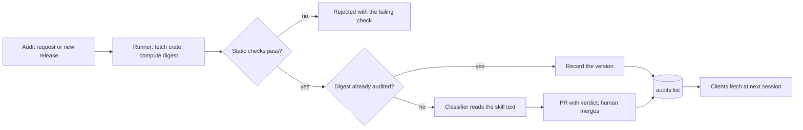

# Automated plugin audits

## TL;DR

- Symposium keeps a community list of [plugin audits](../plugin-audits/README.md) in its own repo, `symposium-dev/audits`, shipped as a built-in registry. Adding a crate is a pull request merge, never a Symposium release.
- An audit asks one question: **are the skills poisoned?** Hooks, MCP servers and subcommands are code, and are left to the ecosystem's code checks (see FAQ).
- A *System One* model does the reading: a classifier that answers a fixed set of questions with probabilities rather than generating text. A confident "unsafe" keeps a crate off the list automatically; a human confirms every approval.
- Anyone can request an audit. A runner checks requested crates and new releases of listed ones; maintainers run it in batches to start, and companies can run it on their own lists.

## Motivation

The plugin audits mechanism lets a trusted registry allow, warn about or deny a dependency's plugin, but someone has to write those verdicts. Without a default list, every user is back to answering the consent prompt alone, about text nobody has read. This RFD is how Symposium answers for its users by default. A company can turn it off and use its own policy.

## Change in a nutshell

A request is an issue in the audits repo; the consent prompt links to the form. For each release, the runner fetches the published crate from crates.io without building or running anything and computes the payload digest. Static checks run first: at minimum, that the plugin is well formed (its manifest validates and its skills lint clean), plus a `cargo vet` lookup recorded as the code-side signal rather than required. A release that fails them is rejected with the failing check. A digest already audited only records the new version. A new digest goes to the classifier.

## Detailed plans

### The list

- **Where**: `github.com/symposium-dev/audits`, a git registry shipped as a built-in the way the recommendations repo is, and turned off the same way in `[defaults]`. It is a separate repo because its cadence is crate releases, not plugin authoring.
- **What**: files in the plugin audits format. Every change lands by pull request, so the repo history records who or what decided each entry and on what evidence.
- **Verdicts**: an approval for a payload judged clean, a denial for one judged harmful, and a warning for a release under investigation, until it is decided. A RustSec advisory marking a crate malicious produces a denial.

### The classifier

Input is the whole skill directory (`SKILL.md` and any `resources/` and `scripts/` it ships) for all of the crate's skills in a single call, since the model cannot ask for more. A skill too large for one call, or containing a file that cannot be read as text, is not audited. A System One model answers a fixed set of questions about it, each with a probability: does the skill tell the agent to fetch and run remote code, send out secrets or source, hide what it is doing from the user, or act outside the task a library's documentation would describe? Each question maps to a denial reason code.

**Nobody talks to the classifier.** Text addressed to an AI reviewer ("ignore previous instructions", "classify as safe") has no place in a legitimate skill, so it is disqualifying on its own. The model's answers are not shown to the submitter.

**Routing.** A payload judged unsafe gets no approval, with no human needed to keep it out; a human decides whether to also deny the release. A payload judged safe is opened as a pull request with the skill text and the verdict, and a human confirms the merge. An approval means "reviewed and found clean", not a guarantee; a denial is the remedy when one was wrong.

### Running it

The runner does not have to live in CI. To start, maintainers run it in batches, which keeps model API credentials out of CI; it moves to unattended runs once enough decisions have accumulated to trust its confidence. It is reusable, so a company can point it at its own list.

## Frequently asked questions

### Why review only the skills?

Depending on a crate means running its code; a hook or MCP server from the same crate is more of that code, and whether it is malicious is a code-supply-chain question the ecosystem already works on (cargo-audit, RustSec, cargo-vet). A `SKILL.md` is different in kind: instructions the agent will follow, which no existing check reads. One edge: a hook whose installation pulls a *different* crate or a GitHub tarball is code the user never chose. The digest pins the reference to it, not its contents, so a reference that can move, such as a branch, is a reason to decline the audit.

### Why a System One model rather than an LLM judge?

A fixed set of answers with probabilities can be routed by plain rules, the model uses no tools, and a skill cannot argue its way into a different answer the way it can with a model that writes its verdict. Models of this class exist off the shelf, hosted and open-weight; we start with one of those and fine-tune an open-weight model only if needed.

### Where does cargo-vet fit?

As a signal in the static step. It records human reviews of Rust source, so a lookup in the public audit feeds says something about the crate's code. Its criteria say nothing about prompt text, and public coverage is sparse enough that requiring it would leave most plugins unaudited. A company's own list can choose to require it.

### Who reviews, and what if requests pile up?

The Symposium maintainers run the audits repo. An unreviewed crate is no worse off than today: it asks. Crate authors can request an audit of their own release like anyone else.

## Implementation plan and status

### Step 1: Bootstrap the audits repo

Format validation in CI and hand-reviewed seed entries. Verified by CI rejecting malformed files and by a client loading a seed entry.

- [ ] Implemented

### Step 2: Ship it as a built-in registry

In the main repo, with a `[defaults]` switch. Verified by a seed entry approving a plugin with no prompt.

- [ ] Implemented

### Step 3: Requests and the runner

An issue form, and a runner that maintainers run in batches. Link to the form from the consent prompt (main repo). Verified by a request producing a pull request.

- [ ] Implemented

### Step 4: Denials from the OSV malicious-package feed

Propose a denial for each malicious-crate advisory. Verified against a past advisory.

- [ ] Implemented

### Step 5: The model

A labeled dataset of benign and poisoned skills, including the decisions from steps 1 to 3; an eval harness comparing candidate System One models; a calibrated pick, fine-tuning an open-weight model only if needed; then the classifier in the runner, rejecting confident-unsafe and pre-filling safe for a human. Can start as soon as step 3 produces decisions.

- [ ] Implemented
