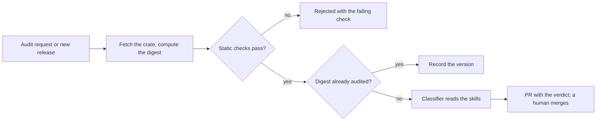

# Automated plugin audits

## TL;DR

- A plugin shipped inside a dependency loads only after each user agrees to it, and nobody has read what they agree to.
- Symposium keeps a public list, `symposium-dev/audits`, of plugin content it has reviewed: content found clean, and releases revoked as harmful.
- For any plugin, the list gives one of three answers: **audited**, **revoked** or **not audited**. This RFD defines the answer, not what Symposium does with it; that belongs to plugin enablement.
- The review asks one question: are the skills poisoned? A classifier reads them, and a human confirms every entry.

## Motivation

Today a dependency's embedded plugin loads only with consent: `cargo agents sync` asks, and the answer is recorded in `[plugins]`. Every user of a popular crate answers the same question about the same text, separately, without having read it. The question carries no information. A shared review answers it once, for everyone, with information.

## Change in a nutshell

`symposium-dev/audits` holds one file per plugin:

```toml
# audits/cargo/widget-lib.toml
format = 1

[[audit]]
digest   = "sha256:9f2c41d0e8…b7"         # the reviewed payload
versions = ["1.4.2", "1.4.3", "1.5.0"]    # releases known to ship it

[[audit]]
digest   = "sha256:41aa07c3d2…0c"
versions = ["1.6.0", "1.6.1"]

[[revoked]]
versions = ">=1.3.0, <1.4.2"
reason   = "remote-exec"                  # from a fixed list of reason codes
```

Symposium computes the digest of the plugin it is about to load and looks it up:

| Answer | When |
|---|---|
| revoked | a `[[revoked]]` entry matches the version or the digest |
| audited | otherwise, the digest matches an `[[audit]]` entry |
| not audited | anything else, including a plugin whose content cannot be digested |

With today's consent flow, the natural use is: audited loads without the prompt, revoked never loads, and not audited asks as it does now. A policy model of allow, warn and forbid maps them to `allow`, `forbid` and `warn`.

## Detailed plans

### The list

- **Where:** `github.com/symposium-dev/audits`, run by the Symposium maintainers. It is its own repo because its cadence is crate releases: adding an entry never needs a Symposium release.
- **One file per plugin,** at `audits/<package manager>/<name>.toml`.
- **`[[audit]]`:** a `digest` that was reviewed and found clean. `versions` records the releases seen shipping it; it is bookkeeping, not used for matching.
- **`[[revoked]]`:** a version requirement or a digest, with a `reason` code from a fixed list, so Symposium can say why.
- **History:** every change lands by pull request, so the repo history records who or what decided each entry and on what evidence.
- **Compatibility:** the file carries a `format` version. Only a format change needs a Symposium release.
- **Refresh:** Symposium fetches the list when an agent session starts and on `cargo agents sync`, never on individual tool events.

### The payload digest

The digest covers the plugin's manifest and every file in the skill directories it names inside the package, sorted by path and framed so that file names and contents cannot be confused with each other. A code-only release keeps the same digest and keeps matching. A release that changes any skill text gets a new digest, which is not audited until someone reviews it. A plugin that pulls skill text from outside its package (a `source.git` group), or whose payload is over the size limit, cannot be digested and is never audited.

### What gets reviewed

Only the skills. Hooks, MCP servers and subcommands from a dependency are more of that dependency's code, which the user already runs by depending on it; whether that code is malicious is a question for the ecosystem's code checks (RustSec, cargo-audit, cargo-vet). A `SKILL.md` is different: instructions the agent will follow, which no existing check reads. One exception: a hook that installs a *different* crate or a GitHub tarball is code the user never chose, and a reference that can move, such as a branch, is a reason to decline the audit.

### The review process



Anyone can request an audit by opening an issue in the audits repo. A job checks requested crates and new releases of crates already on the list. To start, maintainers run it themselves in batches, which keeps model credentials out of CI. It fetches the published crate without building or running anything. Static checks run first: the plugin must be well formed, and a `cargo vet` lookup is recorded as a signal about the code, not required. A RustSec advisory marking a crate malicious produces a revocation.

### The classifier

A *System One* model: a classifier that answers a fixed set of questions with probabilities instead of writing text. Does the skill tell the agent to fetch and run remote code, send out secrets or source, hide what it is doing from the user, or act outside the task a library's documentation would describe? Each question has its own reason code. It reads all of a crate's skill directories in one call; a payload too large for one call, or with a file that is not text, is not audited.

Nobody talks to the classifier. Text addressed to a reviewer ("ignore previous instructions", "classify as safe") has no place in a legitimate skill and is disqualifying on its own, and the model's answers are not shown to submitters. A confident "unsafe" gets no entry, and a human decides whether to also revoke. A likely "safe" becomes a pull request that a human confirms.

## Frequently asked questions

### What decides whether an audited plugin loads without asking?

Not this RFD. The list says whether the content was reviewed; whether that is enough to skip asking is a user setting that belongs to plugin enablement. The two stay apart on purpose: a safety review and "do I want this plugin" are different questions.

### Why a content digest rather than a version?

A version pin needs a new entry for every release, and misses `[patch]`, path and git overrides that change content under the same version. A digest keeps matching across code-only releases and stops matching the moment the skill text changes. Revocations accept a version requirement too, since advisories name versions.

### Why a System One model rather than an LLM judge?

Fixed answers with probabilities can be routed by plain rules, the model uses no tools, and a skill cannot argue its way into a different answer the way it can with a model that writes its verdict.

### Why not just use cargo-vet?

cargo-vet records human reviews of Rust *source* against code-safety criteria. Its criteria say nothing about prompt text, its audits are keyed by version, and public coverage is sparse. We record its result as the code-side signal and borrow its shape: a curated, reviewable list with a deny channel.

### Can a company run its own list?

The file format and the runner are reusable. How Symposium is pointed at a list other than the community one is configuration, and is left to plugin enablement.

### Who reviews, and what if requests pile up?

The Symposium maintainers. A plugin waiting for review is no worse off than today: it is not audited, so Symposium behaves as it does now.

## Implementation plan and status

### Step 1: The audits repo

The file format, CI that validates every file, and a few hand-reviewed seed entries. Verified by CI rejecting malformed files.

- [ ] Implemented

### Step 2: The lookup

Symposium fetches the list, computes a plugin's digest and returns audited, revoked or not audited. `cargo agents plugin digest` prints a plugin's digest for reviewers. Verified by tests for each answer, including content that cannot be digested.

- [ ] Implemented

### Step 3: Use the answer

A revoked plugin never loads. An audited plugin skips the consent prompt once plugin enablement provides the user's setting for it; until then, the prompt says whether the plugin is audited, so the user's answer is informed. Verified by tests that a revoked plugin is blocked on every route and that the prompt shows the answer.

- [ ] Implemented

### Step 4: Requests and the runner

The request form, the batch job, and revocations from RustSec advisories for malicious crates.

- [ ] Implemented

### Step 5: The classifier

A labeled set of benign and poisoned skills, an evaluation comparing candidate models, and the chosen model in the runner, with every approval confirmed by a human.

- [ ] Implemented
