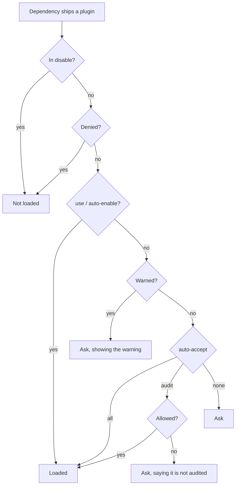

# Plugin audits

## TL;DR

- Today a plugin embedded in a dependency loads only after the user says yes. Every user answers that question alone, about text none of them has read.
- Let a trusted registry give a verdict on such a plugin: **allow**, **warn** or **deny**. A verdict is a security policy, separate from whether the user wants the plugin.
- The user picks what loads without asking with `[plugins] auto-accept`: `none`, `audit` (the default: what a registry allows) or `all`. A denial wins under every setting.
- The built-in registry types answer from `audits/<crate>.toml` files, modeled on cargo-vet: an approval pins a digest of the plugin's payload; a warning or denial names versions or a digest.
- Who writes those files for Symposium's own list, and how, is a separate RFD, *Automated plugin audits*.

## Motivation

The consent prompt in `cargo agents sync` and the `cargo agents use` command ask each user to make the same trust decision about every plugin-bearing dependency, and to make it blind. A registry the user already trusts can make that decision once for everyone who uses it, whether it is Symposium's community list or a company's own.

Whether a plugin is safe and whether the user wants it are different questions. A registry answers the first, per plugin. The user answers the second once, in config, instead of once per crate.

## Change in a nutshell

A trusted registry carries `audits/widget_lib.toml`:

```toml
format = 1
crate  = "widget-lib"

[[audit]]                                   # allow
digest   = "sha256:9f2c41d0e8…b7"           # hash of the plugin payload
versions = ["1.4.2", "1.4.3", "1.5.0"]      # releases known to ship it

[[warn]]
versions = "1.6.0"
note     = "the setup skill pipes a remote script into sh"

[[revoked]]                                 # deny
versions = ">=1.3.0, <1.4.2"
reason   = "remote-exec"                    # code from a fixed list
```

Sync hashes `widget-lib`'s payload (its plugin manifest and every skill directory the manifest names inside the crate), finds the matching `[[audit]]` digest, and loads the plugin with no prompt and no config write. `cargo agents status` lists it as active because of the audit. A release that changes the payload no longer matches and asks again until it is audited as a new entry. A plugin that pulls skill text from outside the crate (a `source.git` group) cannot be pinned by a digest, so it can be warned about or denied, but not allowed.

Precedence for a dependency's plugin, first match wins:



A denial outranks the user's own `use`, because it marks a payload known to be harmful; `cargo agents use` refuses a denied crate and says why. Short of that, `use` and `auto-enable` are standing grants: they trust the crate, not one release, the same way depending on a crate trusts its future code. A warning does not override them; `cargo agents status` shows it. Re-checking each release is the registry's job, and its tool for stopping a release is a denial.

## Detailed plans

### Verdicts

- **Who answers**: only trusted package managers, meaning the configured registries. The cargo transport never answers, so a crate cannot vouch for itself. When several registries answer, a denial from any wins, then a warning, then an approval.
- **What is judged**: plugins embedded in dependencies, and the crates their plugins name. Registry and workspace plugins are trust roots; `[plugins] disable` turns one off.
- **How it is asked**: a new optional operation in the [PM interface](../registry-centric-plugins/pm-interface/README.md), `audit`. Symposium sends the package id and the payload digest (none when the payload cannot be pinned), and the PM answers with a verdict or nothing. The built-in git and path registries answer from `audits/`; a company can answer from its own security tooling instead.

```json
{ "method": "audit", "params": {
    "id": { "pm": "cargo", "name": "widget-lib", "version": "1.6.0" },
    "digest": "sha256:0b17…e2" } }
{ "result": { "verdict": "warn", "note": "the setup skill pipes a remote script into sh" } }
```

Symposium computes the digest, so every PM agrees on what a payload is.

### The payload digest

SHA-256 over the plugin manifest (`Symposium.toml` and `[package.metadata.symposium]`) and every file in each skill directory the manifest names inside the crate, framed and sorted by path. A release that changes only code keeps its digest. A `source.git` skill group, a path that leaves the crate, or a payload over 4 MiB has no digest. `cargo agents plugin digest` prints it, so a list can be kept by hand.

### Chained crates

A plugin can name another crate (`[[plugins]] source.cargo`). The digest pins that name, not the other crate's content, so the named crate is judged on its own. A chain from a registry plugin is vouched for by the registry, as today. A crate named by a dependency's plugin loads only if it is allowed itself or the user enabled it; otherwise it asks, naming the crate that pulled it in.

### When verdicts change

Registries are refreshed when an agent session starts and on `cargo agents sync`, never on individual tool events. A new denial stops hooks at the next event and removes skills at the next sync.

### Compatibility

Each file carries a `format` version, and the client is lenient: a malformed entry is dropped with a warning, and a reason code it does not know still denies. Only a format bump needs a Symposium release.

## Frequently asked questions

### Why does an approval pin a digest rather than a version range?

A version misses `[patch]`, path and git overrides at the same version, and a range approves releases nobody has read. A digest is stable across code-only releases and stops matching the moment the plugin changes. Warnings and denials can name a range, since being too broad there only asks or blocks more often.

### Why not literally cargo-vet?

cargo-vet records reviews of Rust source against code-safety criteria, keyed by version. Its criteria say nothing about prompt text, and a version key needs an entry per release. We borrow its shape, a curated and reviewable list with a deny channel, and key approvals on the payload.

### Can a company run its own list?

Yes. A `[[registry]]` entry can be a local path or a git URL, and any of them may carry `audits/`. A company puts its files in a directory it already ships to developers and points a registry at it. A company with its own security service can answer `audit` from a package manager of its own instead.

### Does a registry's trust carry down a chain?

One hop. A registry vouches for the crates its own manifest names, because that manifest is the registry's content. It does not vouch for what those crates name in turn, since that is their authors' content, which the registry never reviewed.

## Implementation plan and status

### Step 1: `auto-accept` setting

`[plugins] auto-accept = "none" | "audit" | "all"`, default `audit`. Until verdicts exist, `audit` behaves like `none`. Verified by enablement tests for each value and `status` output.

- [ ] Implemented

### Step 2: Audits format, payload digest and denials

Read `audits/` from trusted registries, compute the digest, and withhold a revoked crate over every grant. Add `cargo agents plugin digest`. Verified by format-parsing tests (malformed entries, unknown codes), golden digest vectors, and a revoked crate staying off under `use`.

- [ ] Implemented

### Step 3: Approvals

Load an allowed payload with no prompt under `audit`. The prompt says when a plugin is not audited, and `status` names the registry that audited it. Verified with fixture registries holding matching and stale digests.

- [ ] Implemented

### Step 4: Chained crates

Apply the same rule to crates named by dependency plugins. Verified with chain fixtures, including a named crate the workspace does not depend on.

- [ ] Implemented

### Step 5: The `audit` operation and warnings

Ask registries through the `audit` operation, add `[[warn]]`, and make `cargo agents use` refuse a denied crate. Verified by a warned plugin asking under every `auto-accept` value, and `use` of a denied crate failing with the reason.

- [ ] Implemented
